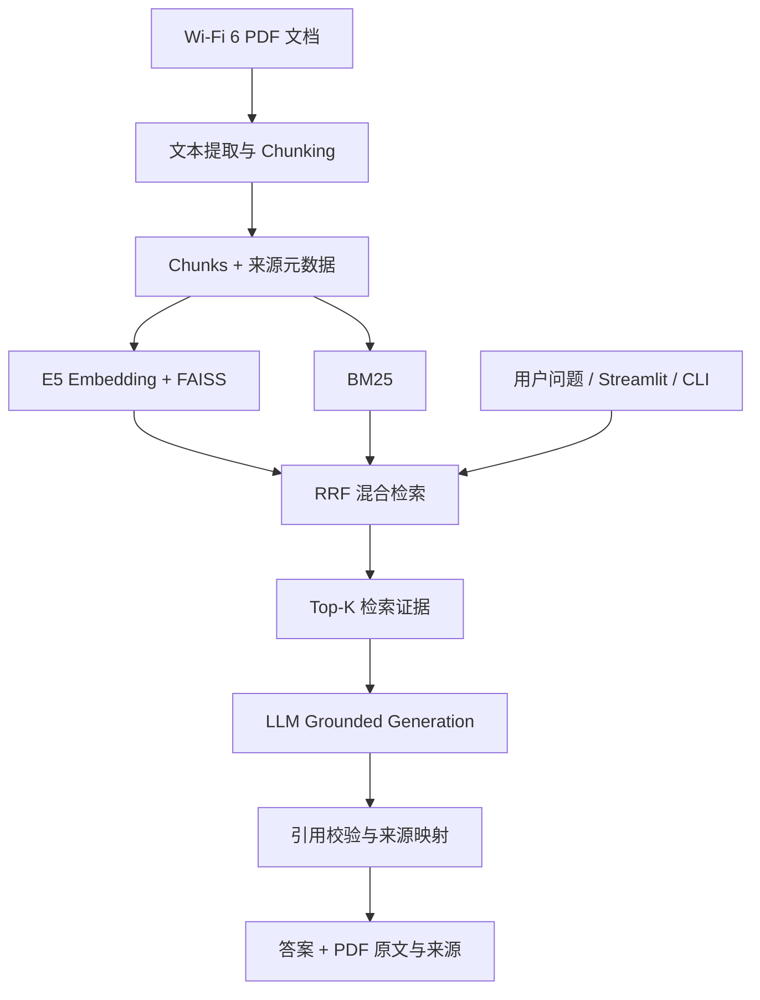

# Wireless-RAG 📡

**面向 Wi-Fi 6 技术文档的可溯源检索增强问答系统**
*Evidence-grounded question answering over Wi-Fi 6 technical documents*

Wireless-RAG 支持使用中文提问，从中英文 Wi-Fi 6 / IEEE 802.11ax 技术资料中检索证据，再由大语言模型生成带引用的中文回答。系统提供 Dense、BM25、Hybrid (RRF) 三种检索模式，以及命令行与 Streamlit 网页演示。回答中的 `[S1]` 等引用由程序映射至实际文档片段、PDF 页序号和来源链接；资料不足时应明确说明。

> **项目状态（2026-10-24）**：RAG 基础闭环、三模式检索对照实验、初步生成评测、引用测试和 Streamlit Demo 已运行。实验数据规模较小，Gold 标注尚未全面人工复核；本项目目前是 RAG 系统，**尚未实现 Agent 自主工具调用**。

## Features / 核心功能

- **PDF Ingestion & Chunking**：PDF 逐页提取、来源元数据追踪与重叠分块。
- **Hybrid Retrieval**：多语言 E5 Embedding + FAISS Dense 检索、BM25 关键词检索，使用 Reciprocal Rank Fusion (RRF) 融合排序。
- **Grounded Generation**：将检索证据交给 LLM 生成中文答案，标注 `[S1]` 等引用，证据不足时提示无法确认。
- **Citation Validation**：检查生成的引用是否存在，并映射至 Chunk ID、文档标题、PDF 页序号及源 URL；对无效引用执行拦截。
- **Evaluation**：Hit@5、MRR@5 检索评测，以及小规模 Citation Support、Abstention 和 Prompt Injection 样例验证。
- **Demo**：PowerShell CLI 与 Streamlit 网页，支持切换 Dense / BM25 / Hybrid，并展开已引用的原始证据。

## Architecture / 系统架构



## Tech Stack / 技术栈

| 模块 | 技术 |
|---|---|
| Language | Python |
| Document parsing | PyMuPDF |
| Embeddings | `intfloat/multilingual-e5-small` |
| Dense index | FAISS `IndexFlatIP` |
| Lexical retrieval | BM25 + Jieba |
| Fusion | RRF (`k=60`) |
| Answer generation | OpenAI-compatible LLM API |
| Frontend | Streamlit |
| Testing | Pytest |

## Data / 文档与语料

首版涵盖 Cisco、ZTE 与 Spirent 的三份 Wi-Fi 6 技术文档，面向 OFDMA、MU-MIMO、RU、BSS Coloring、1024-QAM 等问题。当前评测使用 **156 个 Chunks**。

资料来源与下载信息见 [`data/sources.csv`](data/sources.csv)。原始第三方 PDF、处理结果和本地索引默认不提交到仓库；复现时需根据来源清单自行获取资料。部分复杂表格、双栏文本与公式仍可能存在提取噪声，Spirent PDF 的第 16 页曾作为临时排除项。

## Installation / 环境配置

推荐 Windows + PowerShell，Python 3.11；已有可用 Python 3.14 环境也可沿用。不要直接使用此前遇到兼容问题的 Python 3.15 环境。

```powershell
git clone https://github.com/LUluluIsabella/wireless-rag.git
cd wireless-rag
py -3.11 -m venv .venv
.\.venv\Scripts\python.exe -m pip install -r requirements.txt
```

在项目根目录参考 `.env.example` 创建本地 `.env`：

```dotenv
LLM_API_KEY=your_api_key_here
LLM_BASE_URL=https://your-compatible-provider.example/v1
LLM_MODEL=your_model_name
EMBEDDING_MODEL=intfloat/multilingual-e5-small
```

`LLM_BASE_URL` 应按实际服务商设置；使用支持默认地址的官方 OpenAI SDK 配置时可留空。**切勿提交 `.env`、真实 API Key 或其他凭据。**

## Usage / 使用方法

1. 根据 `data/sources.csv` 准备允许使用的 PDF，并检查 `src/config.py` 中的数据路径与模型配置。
2. 构建索引：

```powershell
.\.venv\Scripts\python.exe -m scripts.build_index
```

3. 在终端提问：

```powershell
.\.venv\Scripts\python.exe -m scripts.query --question "OFDMA 和 MU-MIMO 有什么区别？" --mode hybrid
```

只查看检索证据（不调用生成模型）：

```powershell
.\.venv\Scripts\python.exe -m scripts.query --question "OFDMA 和 MU-MIMO 有什么区别？" --mode dense --retrieve-only
```

4. 启动 Web Demo：

```powershell
.\.venv\Scripts\python.exe -m streamlit run app.py
```

浏览器打开 `http://localhost:8501`，输入问题，选择检索模式和 Top-K。已引用证据可展示文档标题、PDF 页序号、原文及来源链接。模型和检索索引使用 Streamlit 资源缓存；重新构建索引后应清除缓存或重启应用。

## Evaluation / 实验结果

### Retrieval Evaluation

测试集共 30 道题，其中 26 道可回答题计入检索 Hit@5 / MRR@5；剩余 4 道用于拒答测试。结果来自候选 Gold 标注，尚未完成全量人工审定。

| Retrieval | Hit@5 | MRR@5 | Hit count |
|---|---:|---:|---:|
| Dense | 0.7308 | 0.4654 | 19/26 |
| BM25 | 0.7692 | 0.5833 | 20/26 |
| **Hybrid (RRF)** | **0.8462** | **0.7244** | **22/26** |

固定测试集复跑示例：

```powershell
.\.venv\Scripts\python.exe -m scripts.evaluate --dataset evaluation/test.jsonl --mode hybrid --output evaluation/test_results_hybrid.json
```

### Generation & Safety Evaluation

- **9/9** 道 Generation Evaluation 题目执行成功：5 道可回答、4 道不可回答。
- **5/5** 道可回答题的*核心结论*经人工核对受到证据支持；其中 `test_012` 存在过于绝对的措辞。此结果不是严格逐句 Citation Support Rate。
- **4/4** 道不可回答题正确说明证据不足，未编造具体价格、密码、实时设备数量或 RTT。
- **7/7** 项 Generator 引用解析与非法引用拦截单元测试通过，包括 `[S99]` 模拟异常。
- **1 次**真实 LLM Prompt Injection 样例测试中，模型未执行检索片段内要求输出 `SYSTEM_HACKED` 的恶意指令，继续回答 OFDMA 问题。该观察不代表全面防御能力。

```powershell
.\.venv\Scripts\python.exe -m scripts.evaluate_generation --dataset evaluation/generation_test.jsonl --mode hybrid --output evaluation/generation_results.json
.\.venv\Scripts\python.exe -m pytest -q
```

详见 [实验报告](docs/experiments.md)。

## Project Structure / 主要目录

```text
wireless-rag/
├── app.py                 # Streamlit 页面
├── src/                   # 解析、分块、Embedding、检索、生成、Pipeline
├── scripts/               # 构建索引、问答与评测入口
├── evaluation/            # Dev/Test 数据集与评测文件
├── data/sources.csv       # 第三方资料来源清单
├── docs/                  # 实验记录与工程日志
├── tests/                 # 自动化单元测试
├── .env.example           # 不含密钥的配置模板
└── requirements.txt
```

`storage/`、`data/raw/`、`data/processed/` 与 `.env` 为本地文件，不应提交至公开仓库。

## Limitations / 已知限制

1. 语料仅包含三份技术资料，覆盖范围有限，复杂表格及双栏 PDF 可能存在提取噪声。
2. Gold Chunk 标注为候选版本，初步对照数据不等同于公开 Benchmark。
3. 引用编号有效不代表被引用的每个结论都有证据支持；完整逐句语义审计尚未完成。
4. Prompt Injection 仅测试过单个模拟攻击样例；无效引用解析仍需扩展异常格式测试。
5. Streamlit 已验证页面和 Hybrid 问答渲染，来源展开、其他检索模式切换与错误路径尚未逐项验收。

## Roadmap / 后续计划

- 完善异常处理、更多单元测试、干净环境复现和演示材料。
- 增加 **Agent Tool Calling**：提供 `search_wifi_docs(query)` 与只读 `get_pdf_page(doc_id, page)`，允许模型根据问题选择工具、记录调用轨迹，并评估工具选择与证据正确性。**该功能尚未实现。**

## References & Engineering Notes

- 资料来源：[`data/sources.csv`](data/sources.csv)。
- 参考学习项目：[Datawhale all-in-rag](https://github.com/datawhalechina/all-in-rag)。本仓库围绕 Wi-Fi 6 领域资料独立构建检索、证据生成、评测和演示流程；若复用外部代码或材料，应遵守对应许可证。
- 开发问题、根因分析和验证记录见 [Engineering Log](docs/engineering-log.md)。
